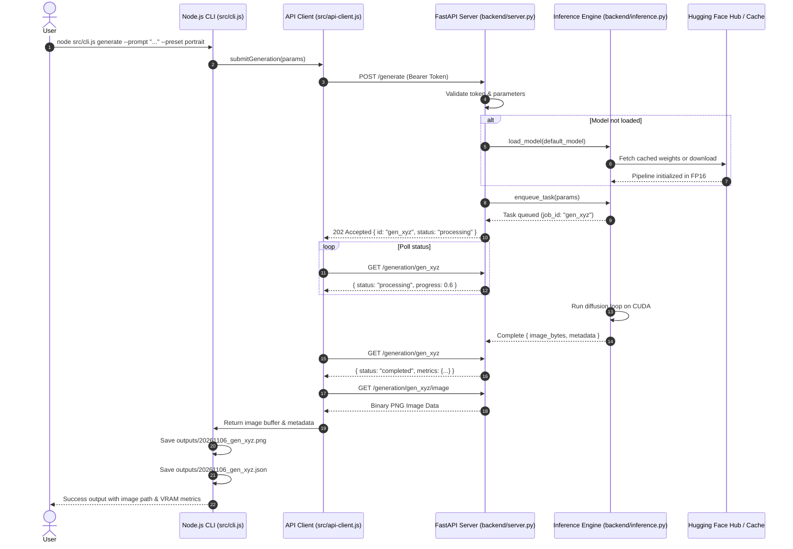

# Architecture Specification: AI Image Studio

## 1. System Overview

AI Image Studio is a hybrid architecture application designed to run generative diffusion models directly on Google Colab GPU hardware while exposing a clean, developer-friendly JavaScript/Node.js client for local control, batch processing, and output management.

```
+-------------------------------------------------------------+
|                     Local Machine (Client)                  |
|                                                             |
|   +-----------------------+     +-----------------------+   |
|   |   Node.js CLI Client  |     |   Local Output Store  |   |
|   |     (src/cli.js)      |     |     (outputs/)        |   |
|   +-----------+-----------+     +-----------^-----------+   |
|               |                             |               |
|   +-----------v-----------+                 |               |
|   |   API Client Layer    |-----------------+               |
|   |  (src/api-client.js)  |   Saves PNG + JSON Metadata     |
|   +-----------+-----------+                                 |
+---------------|---------------------------------------------+
                | HTTPS with Bearer Token Authentication
                | (Secure Reverse Tunnel: Cloudflared / ngrok)
+---------------v---------------------------------------------+
|                  Google Colab Environment (GPU)             |
|                                                             |
|   +-----------------------------------------------------+   |
|   |               FastAPI HTTP Gateway                  |   |
|   |                 (backend/server.py)                 |   |
|   +--------------------------+--------------------------+   |
|                              |                              |
|   +--------------------------v--------------------------+   |
|   |          Inference & Memory Manager Engine          |   |
|   |               (backend/inference.py)                |   |
|   +--------------------------+--------------------------+   |
|                              |                              |
|   +--------------------------v--------------------------+   |
|   |         Hugging Face Diffusers + PyTorch            |   |
|   |      (SDXL Base 1.0, SD 1.5, FP16, Offloading)      |   |
|   +--------------------------+--------------------------+   |
|                              |                              |
|   +--------------------------v--------------------------+   |
|   |                 NVIDIA GPU (T4 / A100)              |   |
|   +-----------------------------------------------------+   |
+-------------------------------------------------------------+
```

---

## 2. Design Principles

1. **Strict Separation of Concerns**: Python is exclusively used as the GPU runtime engine (Diffusers, PyTorch, CUDA, FastAPI). All user-facing business logic, character profile management, prompt templating, configuration parsing, history indexing, and output file management are implemented in standard JavaScript (ES Modules).
2. **Zero Third-Party Image API Dependence**: No calls to hosted third-party inference APIs (fal.ai, Replicate, HF Inference Endpoints). Public weights run on the user's allocated GPU hardware.
3. **Stateless Generation Queue & Deterministic Reproducibility**: Generations are queued sequentially on the GPU to prevent CUDA Out-Of-Memory (OOM) spikes. Requests accept deterministic seeds and return exact seeds and model hashes.
4. **Resilient Communication**: The client includes automated retries, health pinging, exponential backoff, and graceful recovery from Colab disconnects or OOM errors.
5. **Secure Tunnels Only**: Colab endpoints are protected by token authentication (`STUDIO_API_TOKEN`). Unauthenticated public endpoints are disallowed.

---

## 3. Component Details

### 3.1 JavaScript Client Layer (`src/`)

- **`src/config.js`**: Loads and validates configurations from `config/models.json`, `config/generation.json`, and `.env`. Provides sensible defaults for image resolutions, guidance scales, steps, and timeout intervals.
- **`src/api-client.js`**: Native HTTP client using Node.js Fetch API. Manages header injection, token validation, polling for asynchronous generations, error normalization, and binary image streaming.
- **`src/characters.js`**: Reusable fictional character profile parser and prompt synthesizer. Blends character attributes (physical traits, age, wardrobe, photography style) with prompt directives.
- **`src/output.js`**: Disk persistence manager. Atomic writes for image PNG files alongside synchronized JSON sidecar metadata (prompt, seed, model ID, execution duration, generation ID, VRAM usage).
- **`src/cli.js`**: Interactive and non-interactive command line runner. Supports `doctor`, `models`, `generate`, `character`, and `history` commands with structured terminal output.

### 3.2 GPU Inference Backend (`backend/`)

- **`backend/server.py`**: FastAPI application exposing standard REST endpoints: `/health`, `/models`, `/models/load`, `/generate`, `/generation/{id}`, `/generation/{id}/image`. Enforces Bearer token authentication via HTTP headers.
- **`backend/models.py`**: Model catalog and descriptor registry. Defines hardware requirements (minimum VRAM, default resolution, pipeline type) for each supported checkpoint.
- **`backend/inference.py`**: Diffusers wrapper managing the active pipeline lifecycle:
  - Cache management (`HF_HOME`).
  - FP16 precision casting.
  - Memory optimizations: `enable_model_cpu_offload()`, `enable_attention_slicing()`, `enable_vae_slicing()`, `enable_vae_tiling()`.
  - Sequential inference worker loop.
  - CUDA OOM capture and VRAM garbage collection (`torch.cuda.empty_cache()`).

### 3.3 Google Colab Orchestrator (`notebooks/colab_setup.ipynb`)

- Performs automated hardware checks (`nvidia-smi`).
- Installs pinned dependencies via `pip`.
- Establishes a secure reverse tunnel using `cloudflared` (or `pyngrok`).
- Prints the exact URL and authentication token to configure the client.
- Starts Uvicorn ASGI server as a background or foreground process.

---

## 4. End-to-End Sequence Diagram



---

## 5. Security Architecture

1. **Authentication**: All endpoints except root `/` enforce `Authorization: Bearer <STUDIO_API_TOKEN>`. The token is randomly generated or user-defined during Colab notebook startup.
2. **Tunneling**: Cloudflare Tunnel creates an ephemeral, encrypted tunnel straight to the Colab container without opening public local ports or relying on unauthenticated ngrok endpoints.
3. **Sanitization**: Image outputs and log files strip any bearer tokens or credentials. File paths for character profiles and outputs are sanitized against directory traversal attacks.

